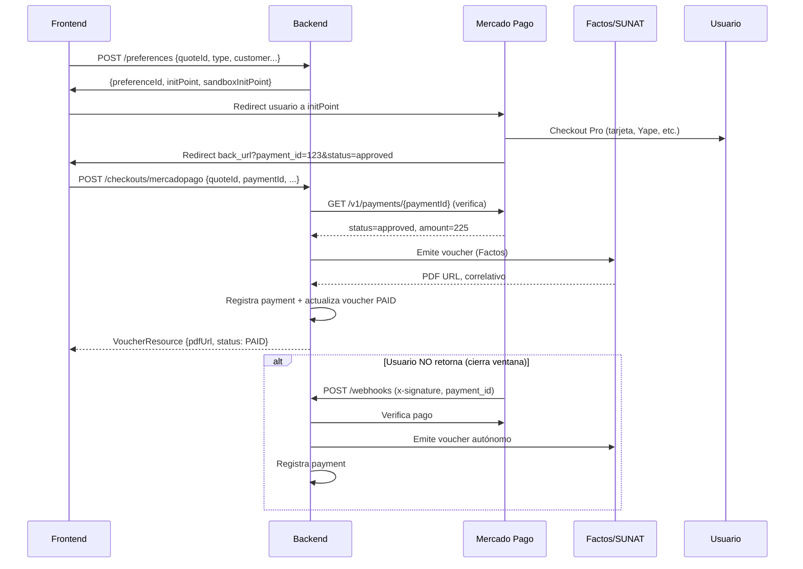

# Billing — Virtual Payments & Mercado Pago Integration

**Base Paths**: `/api/v1/payments`, `/api/v1/payments/mercadopago`  
**Context**: Billing Domain  
**Description**: Pasarela de pagos virtuales extensible (Strategy Pattern) con **Mercado Pago Checkout Pro** activo por defecto.

---

## Guía de Integración para Frontend (Web y Mobile)

### Escenario A: Pago en línea desde la App del Cliente (Autoservicio)
1. **Seguimiento de la Orden (Solo Lectura):**
   - `GET /api/v1/work-orders/me` (o `GET /api/v1/work-orders/{id}`) → muestra estado de la OT (`PENDING`, `IN_PROGRESS`, `COMPLETED`, `PAID`), tareas, `assignedMechanicName` y fotos `evidenceImages`.
2. **Consultar Cotización:**
   - `GET /api/v1/quotes/me` → obtiene la cotización asociada a la OT.
3. **Aprobar Cotización (si está en `DRAFT`):**
   - `POST /api/v1/quotes/{quoteId}/approvals` → pasa la cotización a `APPROVED`.
4. **Iniciar Pago Virtual (cuando la OT está `COMPLETED`):**
   - `POST /api/v1/payments/sessions` con `{ "quoteId": "...", "provider": "MERCADO_PAGO" }` (o `POST /api/v1/payments/mercadopago/preferences`).
   - Abrir `checkoutUrl` (o `sandboxCheckoutUrl` en pruebas) en WebView / navegador. Dentro de Mercado Pago el cliente elige tarjeta, Yape u otro medio habilitado.
5. **Confirmación Automática:**
   - El webhook `POST /api/v1/payments/mercadopago/webhooks` confirma el pago y marca el comprobante interno y la OT como `PAID` (sin requerir Factos cuando `billing.electronic-invoicing.enabled=false`).

### Escenario B: Pago Presencial en Caja del Taller (Staff)
- Si el cliente prefiere pagar en el taller (efectivo, POS físico o transferencia), el cajero/asistente/dueño registra el cobro en **`POST /api/v1/checkouts`** enviando `method` (`CASH`, `CREDIT_CARD`, `DEBIT_CARD`, `BANK_TRANSFER`).

---

## `POST /api/v1/payments/sessions` — Crear Sesión de Pago Virtual (Agnóstico de Pasarela)

**Security**: `@PreAuthorize("isAuthenticated()")` — Staff de la sede o el **cliente dueño de la OT** (cuando la OT está `COMPLETED`)  
**Description**: Crea una sesión de pago en la pasarela seleccionada (`MERCADO_PAGO` por defecto).

### Request

```json
{
  "quoteId": "q1q2q3q4-1234-5678-90ab-cdef12345678",
  "provider": "MERCADO_PAGO",
  "type": "RECEIPT",
  "customerDocumentType": "DNI",
  "customerDocumentNumber": "75981176",
  "customerName": "Alan Mamani"
}
```

### Success Response (201 CREATED)

```json
{
  "provider": "MERCADO_PAGO",
  "sessionId": "123456789-abcdef-1234",
  "checkoutUrl": "https://www.mercadopago.com.pe/checkout/v1/redirect?pref_id=123456789-abcdef-1234",
  "sandboxCheckoutUrl": "https://sandbox.mercadopago.com.pe/checkout/v1/redirect?pref_id=123456789-abcdef-1234",
  "amount": 150.00,
  "currency": "PEN",
  "externalReference": "q1q2q3q4-1234-5678-90ab-cdef12345678"
}
```

---

## `POST /api/v1/payments/mercadopago/preferences` — Crear Preferencia de Pago

**Security**: `@PreAuthorize("isAuthenticated()")` — Staff autorizado de la sede (`isAuthorizedForBranch(quote.branchId)`) o el **cliente dueño de la orden de trabajo** (cuando la OT está `COMPLETED`)  
**Description**: Genera preferencia MP desde cotización `APPROVED`. Persiste `PaymentIntent` para webhook autónomo. Si `billing.electronic-invoicing.enabled=false`, al confirmarse el pago se marca el comprobante interno y la OT como `PAID` sin invocar a Factos.

### Request

| Campo | Tipo | Requerido | Descripción |
|-------|------|-----------|-------------|
| `quoteId` | UUID | Sí | Cotización `APPROVED` (misma sede) |
| `type` | string (enum) | No | `RECEIPT` (default) o `INVOICE` |
| `customerDocumentType` | string (enum) | No | `DNI` (default) o `RUC` |
| `customerDocumentNumber` | string | No | Documento (default: `00000000`) |
| `customerName` | string | No | Nombre (default: `Cliente General`) |

**Request Example**:
```json
{
  "quoteId": "q1q2q3q4-1234-5678-90ab-cdef12345678",
  "type": "RECEIPT",
  "customerDocumentType": "DNI",
  "customerDocumentNumber": "48765432",
  "customerName": "María Fernández"
}
```

### Success Response (201 CREATED)

```json
{
  "preferenceId": "123456789-abcdef-1234",
  "initPoint": "https://www.mercadopago.com.pe/checkout/v1/redirect?pref_id=123456789-abcdef-1234",
  "sandboxInitPoint": "https://sandbox.mercadopago.com.pe/checkout/v1/redirect?pref_id=123456789-abcdef-1234",
  "amount": 225.00,
  "currency": "PEN",
  "externalReference": "q1q2q3q4-1234-5678-90ab-cdef12345678"
}
```

### Error Responses

| HTTP Code | Error Code | Descripción |
|-----------|------------|-------------|
| 400 | `VALIDATION_ERROR` | RUC requerido para Factura, documento inválido |
| 403 | `ACCESS_DENIED` | Sin acceso a la sede |
| 404 | `NOT_FOUND` | Cotización no existe |
| 409 | `CONFLICT` | Cotización no `APPROVED`, ya facturada |
| 500 | `UNEXPECTED_ERROR` | Error MP API |

### Important Considerations

- **Validación Factura**: Si `type=INVOICE` → requiere `customerDocumentType=RUC` (11 dígitos), `customerName` obligatorio
- **PaymentIntent**: Se guarda `quoteId`, `type`, datos cliente, `amount` → usado por webhook si cliente no retorna
- **External Reference**: `quoteId` → permite reconciliación en webhook
- **Moneda**: Siempre `PEN` (soles peruanos)

---

## `POST /api/v1/payments/mercadopago/webhooks` — Webhook Oficial MP

**Security**: **Público** — Validación HMAC `x-signature` + Rate Limiter (60 req/min)  
**Description**: Notificaciones asíncronas de MP (pago aprobado, reembolso, chargeback). Emite voucher + concilia automáticamente.

### Headers Requeridos

| Header | Descripción |
|--------|-------------|
| `x-signature` | HMAC SHA256 (`ts,v1`) — validado con `mercadopago.webhook.secret` |
| `x-request-id` | ID único de notificación MP |

### Query Parameters

| Param | Descripción |
|-------|-------------|
| `id` / `data.id` | Payment ID (MP) |
| `type` / `topic` | Tipo notificación (`payment`, `merchant_order`) |

### Validaciones de Seguridad

1. **HMAC**: `x-signature` = `ts=timestamp,v1=hmac_sha256(manifest, secret)` — manifiesto: `id:{id};request-id:{x-request-id};ts:{ts};`
2. **Freshness**: `ts` no > 5 min diferencia con servidor
3. **Rate Limit**: 60 req/min por IP (exceso → 429)

### Procesamiento (Pago Aprobado)

```
1. Valida HMAC + freshness
2. Obtiene paymentId → consulta MP API `/v1/payments/{id}`
3. Si status = "approved" / "succeeded":
   a. externalReference = quoteId
   b. Si voucher ya existe y PAID → 200 OK (idempotente)
   c. Si voucher PENDING/EMISSION_FAILED → reintenta emisión (retry)
   d. Si NO existe voucher:
      - Busca PaymentIntent guardado en step 1 (preferences)
      - Valida monto MP == monto Intent
      - Emite voucher vía ProcessMercadoPagoCheckoutCommand
      - Si éxito → 200 OK
      - Si falla Factos → 503 (MP reintentará)
4. Si status = "refunded" / "charged_back" → Log WARNING (requiere reconciliación manual)
5. Otros status → 200 OK (ignora)
```

### Responses

| HTTP Code | Descripción |
|-----------|-------------|
| 200 OK | Procesado OK (cuerpo vacío) — MP considera atendido |
| 400 Bad Request | Monto MP ≠ Intent amount |
| 401 Unauthorized | HMAC inválido o timestamp > 5 min |
| 503 Service Unavailable | Sin secret, sin PaymentIntent, o emisión falló → MP reintenta |

### Important Considerations

- **Autonomía**: Webhook emite voucher **sin intervención del cliente** (si no volvió a la app)
- **Reintentos**: MP reintenta por ~72h con backoff exponencial ante 503
- **Idempotencia**: `externalReference` (quoteId) evita duplicados
- **Reconciliación**: `refunded`/`charged_back` → alerta manual (no auto-reversa voucher)
- **Config Requerida**: `mercadopago.webhook.secret` en env (obligatorio para producción)

---

## Flujo Completo MP (Frontend + Backend)



---

## Configuración Requerida (Environment)

```bash
# Mercado Pago
MERCADOPAGO_ACCESS_TOKEN=APP_USR-xxxxxxxxxxxxxxxx
MERCADOPAGO_WEBHOOK_SECRET=whsec_xxxxxxxxxxxxxxxx  # Obligatorio para webhook

# Factos (SUNAT)
FACTOS_API_URL=https://factos-gi5r.onrender.com
FACTOS_API_KEY=xxxxxxxxxxxxxxxx
```